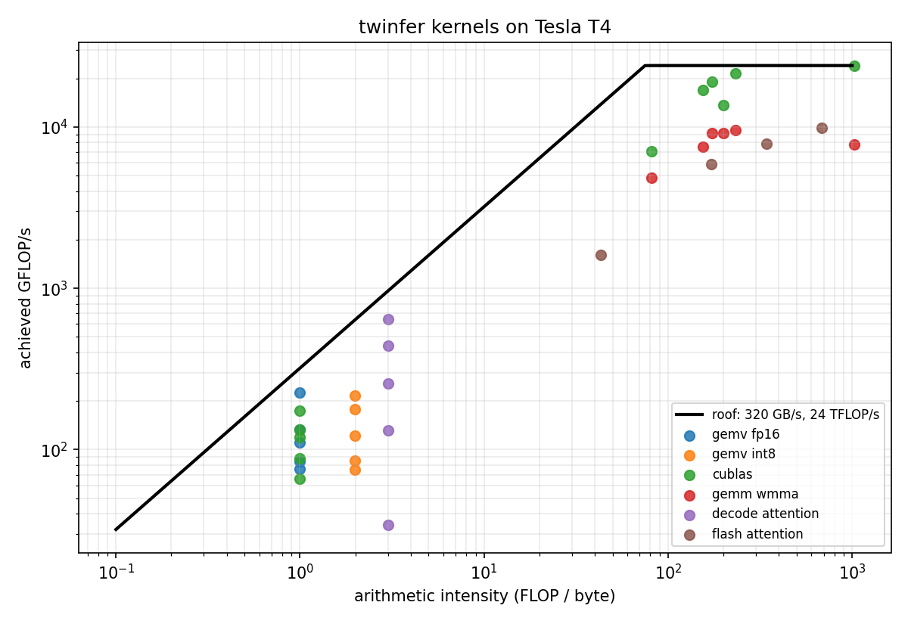

# twinfer

A small LLM inference engine written from scratch, with two GPU backends: CUDA and WebGPU.

It runs [SmolLM2-135M-Instruct](https://huggingface.co/HuggingFaceTB/SmolLM2-135M-Instruct) (and other
Llama-style models) without PyTorch or any ML library. Every kernel is hand-written, once in CUDA C++
and once in WGSL, so the same model also runs in a browser tab.

[](https://github.com/Yashvardhan0505/twinfer/actions/workflows/ci.yml)

Browser demo: https://yashvardhan0505.github.io/twinfer/ (Chrome or Edge with WebGPU)

## Why

I wanted to see where the time actually goes when a model generates text, and the best way to
find out is to write every piece yourself and measure it. A 135M model is small enough to iterate
on quickly, and it makes one thing very obvious: generating a token is almost pure memory traffic.
Each token reads all 269 MB of fp16 weights once, so most of the work is moving bytes efficiently
and not wasting time on kernel launches.

Writing the same pipeline twice is also a good way to separate the ideas from the API. Warp
shuffles, tensor cores and CUDA graphs don't exist in WebGPU, so each of them needs a different
answer there.

## How it works

Generation has two phases, and they use different kernels:

```
prompt (prefill, T tokens)          next token (decode, 1 token)
--------------------------          ----------------------------
tensor-core GEMM (WMMA)             fused RMSNorm + GEMV, fp16 or int8
flash attention (WMMA)              split-KV attention over the KV cache
         |                          GEMV + SwiGLU / residual epilogues
         |                          whole step replayed as one CUDA graph
         +-------> fp16 KV cache <-------+
```

CUDA (`cuda/`):
- GEMV kernels for decode with RMSNorm, bias, residual add and SwiGLU fused in, so a transformer layer is 7 launches instead of 15+
- weight-only int8 with per-row scales, dequantized with a `__byte_perm` trick instead of int-to-float conversion instructions
- decode attention split across the context (flash-decoding style), where one block serves all the query heads that share a KV head
- a WMMA tensor-core GEMM and a FlashAttention-style kernel for the prompt
- the decode step is captured once as a CUDA graph and replayed for every token

WebGPU (`web/`) runs the same decode pipeline in WGSL. Weights are stored as packed fp16 pairs in
`u32` and unpacked in the shader, so it doesn't need the `shader-f16` feature. bf16 weights get
converted on the GPU at load time. There's a small chat page that pulls the model straight from
Hugging Face.

There's also a plain fp32 CPU implementation (`cpu/`) that everything else is checked against, and
a BPE tokenizer written twice (C++ and JS).

The reasoning behind each kernel is in [docs/DESIGN.md](docs/DESIGN.md).

## Numbers

TODO: fill these in from a real GPU run. `notebooks/colab_quickstart.ipynb` prints the tables.

SmolLM2-135M-Instruct, batch size 1, GPU: ?

| backend | prefill tok/s (512-token prompt) | decode tok/s | ms/token |
|---|---|---|---|
| CUDA fp16 + graph | | | |
| CUDA fp16, no graph | | | |
| CUDA int8 + graph | | | |
| WebGPU (Chrome) | | | |
| CPU fp32 | | | |

<!-- roofline from tools/roofline.py goes here:  -->

For reference: decode has to read every weight once per token, so on a T4 (320 GB/s) the
bandwidth limit works out to roughly 1,190 tok/s with fp16 weights and 2,370 tok/s with int8.
How close the real numbers get to that is the interesting part.

## Running it

CUDA needs an NVIDIA GPU with compute capability 7.5 or newer on CUDA 13 (7.0 still works with
CUDA 12.x). RTX 50-series GPUs (sm_120) need CUDA 12.8 or newer. A free Colab T4 works too.

Download the model (on Windows, type `python` instead of `python3`):

```bash
pip install huggingface_hub
python3 -c "from huggingface_hub import snapshot_download as d; d('HuggingFaceTB/SmolLM2-135M-Instruct', local_dir='models/smollm2-135m', allow_patterns=['*.json','*.jinja','*.safetensors'])"
```

Linux:

```bash
make cuda ARCH=native                                       # or `make cpu` for the CPU engine only
./build/twinfer-cuda -m models/smollm2-135m -p "Explain warp divergence in one sentence."
./build/twinfer-cuda -m models/smollm2-135m -i              # chat
./build/twinfer-cuda -m models/smollm2-135m --bench 256     # decode speed; try --int8 and --no-graph too
./build/twinfer-cuda -m models/smollm2-135m --bench 1 --bench-prompt 512   # prefill speed
./build/bench-kernels --csv bench.csv                       # kernels vs cuBLAS
python3 tools/roofline.py bench.csv -o docs/roofline.png
```

Windows, in PowerShell, with Visual Studio 2022 or its Build Tools ("Desktop development with C++"),
the CUDA Toolkit and CMake 3.24 or newer:

```powershell
cmake -B build                               # add -DCMAKE_CUDA_ARCHITECTURES=120 if it can't detect the GPU
cmake --build build --config Release
.\build\twinfer-cuda.exe -m models\smollm2-135m -p "Explain warp divergence in one sentence."
.\build\twinfer-cuda.exe -m models\smollm2-135m --bench 256
.\build\bench-kernels.exe --csv bench.csv
```

If `cmake` isn't found, it is only on PATH inside the Developer PowerShell for VS; `winget install
Kitware.CMake` fixes that. If CMake reports "No CUDA toolset found", reinstall the CUDA Toolkit with
its Visual Studio Integration component. CMake also works on Linux, and without CUDA (or with
`-DTWINFER_CUDA=OFF`) it builds just `twinfer-cpu`.

CPU only: the same commands with `twinfer-cpu`.

Browser: open the demo link, or run `python3 -m http.server 8000` in the repo and go to
http://localhost:8000/web/.

Useful flags: `--temp`, `--top-p`, `-n`, `--ctx`, `--system`, `--raw` (no chat template).

## Testing

Most of the tests run without a GPU:

- `make test` (CMake: `ctest --test-dir build -C Release -LE gpu`): CPU engine vs an independent numpy implementation, and the C++ tokenizer vs the JS one. Needs `pip install numpy`; the tokenizer comparison also needs Node.
- `make test-emu` (Linux): runs the real CUDA kernels on the CPU through a small emulator (`tests/cuda_emu/`). It's slow, but it catches indexing and sync bugs, and CI runs it on every push.
- `python3 tests/web_test.py`: the WebGPU engine in headless Chrome (software adapter) vs the C++ engine
- `make test-cuda` (CMake: `ctest --test-dir build -C Release -L gpu`): kernel unit tests and end-to-end checks on an actual GPU
- `python3 tools/hf_compare.py models/smollm2-135m --cuda`: tokenizer, logits and greedy output against Hugging Face transformers

The kernel tests fill padding and unused KV-cache rows with NaN on purpose, so an out-of-bounds
read shows up as NaN instead of quietly passing.

## Layout

```
common/          safetensors loading, config, tokenizer, sampler, CLI
cpu/             fp32 reference engine
cuda/kernels/    the CUDA kernels
cuda/            engine, CLI, kernel tests, benchmarks
web/             WebGPU demo (src/engine.js, src/shaders/*.wgsl)
tests/           test scripts and the CUDA emulator
tools/           tiny test model generator, numpy reference, HF comparison, roofline plot
docs/DESIGN.md   design notes
```

## Limitations / next steps

- The prefill GEMM is a straightforward WMMA kernel and it's well behind cuBLAS. Next is a double-buffered `cp.async` pipeline with bigger tiles, then `mma.sync`.
- Flash attention uses WMMA plus a shared-memory trick for the row rescaling. An FA-2 style version with `mma.sync` would keep that in registers.
- int4 weights would roughly halve decode memory traffic again.
- The WebGPU side doesn't have split-KV attention, batched prefill or int8 yet.
- Only Llama / Qwen2 style models without RoPE scaling, so no Llama 3.x for now.

## Credits

SmolLM2 by Hugging Face. FlashAttention (Dao et al.) and Flash-Decoding for the attention algorithms.
Karpathy's llama2.c and llm.c were a big inspiration for doing the whole thing from scratch.

MIT license.
